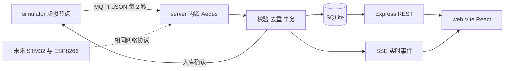

# 教室环境质量监测软件 MVP 计划书

版本：0.1  
日期：2026 年 10 月 16 日  
当前阶段：工作区初始化与开发规划

## 1 项目目标

在 MCU 硬件尚未就绪的条件下，先完成可演示、可查询、可验证的数据闭环：虚拟节点每 2 秒经 MQTT 上传数据，本地 Node.js 服务校验并写入 SQLite，React 网页实时展示五项指标、历史曲线与报警状态。硬件准备完成后，新建 MCU 项目，以 STM32F103C8T6 和 ESP8266 实现相同的网络接口，继续使用现有后端与网页。

本计划以已有任务书与开题报告为需求背景，并以本次确认的软件路线为实施依据。任务书中的第三方云平台、Python Flask 和 GP2Y1010 粉尘数据口径，需要在后续论文与附件修订时同步为本项目实际方案；本次不修改原始 Word 文件。

## 2 已确认的技术决策

| 项目 | 已确认内容 |
| --- | --- |
| 三个软件项目 | `Projects/simulator`、`Projects/server`、`Projects/web` |
| MCU 开发安排 | 以后另建项目，本期不设计硬件、不编写固件 |
| 后续硬件 | STM32F103C8T6 与 ESP8266；粉尘传感器为 GP2Y1010 |
| 运行位置 | 当前 Windows 电脑，本地运行 |
| 上传周期 | 2000 ms，可配置，默认一个教室、一个节点 |
| 后端 | Node.js JavaScript、Express、内嵌 Aedes MQTT 服务、SQLite |
| 网页通信 | REST 查询与设置，SSE 接收实时更新 |
| 前端 | Vite 与 React；浅色中文仪表盘，适配手机浏览器 |
| 首版功能 | 实时看板、历史查询、网页报警、阈值设置、断线补传验证 |
| 账号体系 | 首版不做登录 |
| 手机原生应用 | 暂不开发，后续复用后端 API |

## 3 MVP 功能与边界

### 3.1 虚拟上传节点

生成温度、相对湿度、CO₂、粉尘浓度估算值、光照强度五项数据。数据具有连续趋势和适度噪声，支持固定随机种子，便于重复演示。程序提供正常、超限、恢复、缺测、断网和重复消息情景。

虚拟节点必须真正通过 MQTT 向后端上传。网页展示后端持久化的数据；历史演示数据也通过同一上传链路写入。每条虚拟数据带 `source: simulator` 标记，网页持续显示虚拟节点状态。

### 3.2 本地后端

内嵌 MQTT Broker，完成 JSON 解码、字段校验、设备与主题匹配、去重、SQLite 存储、报警计算和 API 输出。成功入库后发送应用层确认，再向网页推送事件。数据库失败时不发送成功确认。

首版一个后端进程即可，但接入、存储、报警和接口分模块组织，保留以后替换 Broker 或 SQLite 驱动的空间，不引入微服务或额外数据库。

### 3.3 Web 网页

实时看板显示教室名称、设备连接状态、数据新鲜度、五项指标、最近更新时间和短时间趋势。历史页支持时间范围、指标筛选、聚合曲线和分页明细。报警页显示触发、持续、恢复记录；阈值页可调整各指标上下限、恢复边界与连续触发次数。

页面提供加载、空数据、查询失败、连接重试和缺测状态。动画包括数字变化、曲线更新、指标状态过渡和页面切换，不持续播放遮挡内容的装饰动画。默认不播放声音；物理 LED 和蜂鸣器留到硬件阶段。

### 3.4 本期不实现的内容

不实现 STM32 与 ESP8266 固件、接线和 PCB，不实现原生手机应用、账号权限、第三方云平台对接、远程硬件控制、OTA、复杂环境综合评分或健康合规评估。

## 4 总体架构

建议默认端口为 MQTT `1883`、HTTP `3000`、Vite `5173`。本地开发先监听 `127.0.0.1`，网页通过 Vite 代理访问后端。后续需要手机浏览器或真实设备接入时，再调整局域网监听、防火墙和设备访问控制。

三个项目使用独立的 npm 依赖、锁文件与 node_modules，不使用 npm workspaces。三个 Agent 可以在各自项目目录并行编码、安装和独立验证，只共用已约定的 MQTT 与 HTTP 接口；跨项目联调在对应服务可用后进行。

## 5 数据与接口设计

### 5.1 数据口径

| 指标 | 统一字段 | 单位 | 展示说明 |
| --- | --- | --- | --- |
| 温度 | `temperature_c` | °C | 温度 |
| 相对湿度 | `humidity_rh` | %RH | 相对湿度 |
| 二氧化碳 | `co2_ppm` | ppm | CO₂ 浓度 |
| 粉尘 | `dust_ug_m3` | μg/m³ | GP2Y1010 粉尘浓度估算值 |
| 光照 | `illuminance_lux` | lx | 光照强度 |

GP2Y1010 官方资料描述粉尘密度与模拟输出的关系。本项目据此保留通用粉尘字段，不将其直接标为 PM2.5。若原始结果单位为 mg/m³，由未来硬件适配层换算为统一的 μg/m³。其标定、零点和滤波方法留到硬件阶段验证。[Sharp 官方数据手册](https://global.sharp/products/device/lineup/data/pdf/datasheet/gp2y1010au_e.pdf)

设备标识、启动批次、递增序号和采样时间与测量值一同上传。传感器缺测使用 `null`，网页显示缺测，不能用零代替。采样时间未知时使用 `null` 并标记时间质量，不能将补传接收时间伪装成真实采样时间。

### 5.2 接口契约

详细约定见 [数据接口协议草案](数据接口协议草案.md)，机器可读字段定义见 [telemetry.schema.json](contracts/telemetry.schema.json)，配套样例见 [telemetry.example.json](contracts/telemetry.example.json)。文档版本 0.1 表示规划草案；拟定的网络协议主版本为 `v1`，实现前完成第一次冻结。

MQTT 使用 3.1.1 与 QoS 1。Aedes 官方资料列明支持 MQTT 3.1.1，本项目不依赖 MQTT 5 特性。[Aedes 官方仓库](https://github.com/moscajs/aedes)

后续硬件接入保持主题、字段名、单位、去重键和入库确认语义一致。STM32 与 ESP8266 之间的串口帧格式和校验另行设计，由适配层映射为本协议，不把虚拟节点的 Node.js 实现带到 MCU 中。

### 5.3 SQLite 模型

| 表 | 关键内容 |
| --- | --- |
| rooms | 教室 ID 与名称，默认初始化一条 |
| devices | 设备 ID、所属教室、来源、最近接收与连接状态 |
| measurements | 采样时间、接收时间、时间质量、五项数值、原始消息标识 |
| threshold_rules | 指标上下限、恢复边界、连续次数和规则版本 |
| alarm_events | 触发、恢复、规则版本及关联测量记录 |

`measurements` 对 `(device_id, boot_id, seq)` 建唯一约束，对设备与有效时间建立查询索引。数据库持久化教室归属，上传数据中的 `room_id` 必须与设备配置匹配。使用参数化 SQL、事务、WAL 和有限的忙等待；首次实现时加入可重复执行的数据库迁移。

优先采用当前环境已验证的 `node:sqlite`，封装在存储模块中。Node.js 24.15.0 的官方资料将该 API 标为候选稳定阶段，项目固定 Node.js 24 系列；同步查询必须限制范围和返回数量，避免阻塞实时接入。[Node.js SQLite 文档](https://nodejs.org/download/release/v24.15.0/docs/api/sqlite.html)

## 6 上传可靠性与异常处理

1. 每条采样先写入虚拟节点的本地持久队列，再发送 MQTT 消息。
2. 收到 MQTT PUBACK 后继续保留队列记录，等待后端应用层确认。
3. 后端校验通过后执行事务；首次保存返回 `stored`，相同内容的重复消息返回 `duplicate`。
4. 虚拟节点只有收到匹配的 `stored` 或 `duplicate` 才移出队列。超时、断网和临时存储失败保留数据并退避重试。
5. 格式错误、身份不匹配或同一标识对应不同内容时进入可查看的拒收队列，避免无限重发。

MQTT 的确认不要求接收方已经完成应用消息处理，因此本项目另设事务提交后的确认，用来覆盖 Broker 收到数据、数据库尚未保存这一间隙。[OASIS MQTT 3.1.1 标准第 4.3.2 节](https://docs.oasis-open.org/mqtt/mqtt/v3.1.1/os/mqtt-v3.1.1-os.html)

默认预留 24 小时离线队列，即每设备 43,200 条记录；容量耗尽时明确记录缓存已满并停止接纳新采样，不静默丢弃旧记录。实际断线保障受存储容量、持久化成功和磁盘状态限制。首版验证网络断开、应用重启与确认丢失，不承诺任意断电下绝对不丢数据。

历史补传仍按原采样时间存储，不反向覆盖较新的最新读数，不触发已经过期的实时报警。在线状态和数据是否过期分别判断，收到旧数据不代表已有新采样。

## 7 实时展示与查询

SSE 适合后端向网页单向发送新数据与状态；阈值更新继续使用 REST。网页同一页面维护一条事件连接，事件包含持久记录 ID 以便去重。连接重建后重新读取最新快照和当前曲线范围，不承诺无限重放离线期间的 SSE 事件。[MDN SSE 文档](https://developer.mozilla.org/en-US/docs/Web/API/Server-sent_events/Using_server-sent_events)

2 秒上传对应每分钟 30 条、每天 43,200 条、30 天约 129.6 万条每设备。实时图维护有限窗口；历史曲线按时间范围聚合并限制在 1200 点以内，明细默认每页 100 条、最多 1000 条。查询默认最近 24 小时，跨月查询必须聚合，不一次把全部原始数据送到浏览器。

首版不自动删除历史数据。实现阶段记录样本数据量和实际文件体积，再决定是否增加保留天数与归档功能。用于答辩的历史样本通过受控 MQTT 回放生成，并保留虚拟来源和真实的样本时间。

## 8 报警与界面规则

报警阈值作为可配置的工程演示规则，不直接沿用原附件中的空气质量标准数字。涉及标准时应另外核对正式文本、指标定义和平均时长，尤其不能将通用粉尘瞬时估算值当成 PM2.5 日均值。

建议默认连续 3 次新鲜有效采样超限才触发，连续 3 次进入恢复边界后解除；2 秒周期下，首次超限至确认触发约为 4 秒。缺测和过期不计作正常或恢复。保存阈值规则版本，修改阈值后从下一条新鲜采样开始重新累计，不追溯修改既有报警记录。

界面建议使用浅暖灰背景、白色内容卡片、青绿色正常状态、橙色提示和红色报警；颜色同时配合文字、图标与数值。数字过渡和页面切换建议 200 至 400 毫秒，曲线更新在下一次 2 秒采样到来前完成。开启系统减少动态效果时，保留必要的状态反馈并减少动画。

建议使用 ECharts 绘制趋势，先用 CSS 完成布局和过渡。React 使用 JavaScript JSX，首版不引入 TypeScript、全局状态库或额外动画库，只有在实际复杂度需要时再增加。

## 9 实施阶段与交付物

以下为开发工作日估算，开始日期和答辩截止日期尚未约定，不映射为学校学期周次。

| 阶段 | 预计工作量 | 交付物与完成条件 |
| --- | --- | --- |
| M0 工作区与规划 | 本次完成 | 三项目清单、工作区配置、计划书、决策记录、协议与字段样例 |
| M1 可运行骨架与协议冻结 | 1 天 | 安装并锁定兼容依赖，Vite React 骨架、HTTP 健康检查、MQTT 连接、建表迁移、字段校验 |
| M2 数据闭环 | 1 至 2 天 | 虚拟节点 2 秒上传、SQLite 持久化、应用确认、幂等去重、最新与历史 API |
| M3 实时界面与动画 | 2 天 | 五项指标、有限窗口趋势、连接与过期状态、SSE 重连同步、手机布局 |
| M4 历史与报警 | 1 至 2 天 | 时间查询、聚合分页、阈值配置、触发与恢复记录 |
| M5 可靠性与演示验收 | 1 至 2 天 | 断网和重启补传、重复拒收、演示数据、启动说明及验收记录 |
| 后续硬件接入 | 硬件就绪后另排 | MCU 与 ESP8266 实现、真实传感器标定、物理声光报警、串口及网络联调 |

软件 MVP 合计约 6 至 9 个开发工作日，不含硬件与学校论文审阅时间。阶段之间可在数据接口稳定后适度交错，但先完成数据闭环，再完善视觉细节。

## 10 验收标准

| 场景 | 验收方式 |
| --- | --- |
| 正常上传 | 受控生成 300 条唯一采样，约 10 分钟；队列排空后数据库新增 300 条，网页持续更新 |
| 数据持久化 | 后端停止并重启后，既有历史仍可查询，不以网页内存作为数据来源 |
| 断线补传 | 上传期间断开 60 秒，生成约 30 条待发数据；恢复并排空后数量与生成清单一致 |
| 上传端重启 | 队列未清空时退出并重启，保留原消息标识并继续补传，不覆盖旧队列 |
| 确认丢失 | 入库后人为忽略确认并重发，返回重复确认，数据库不增加重复行 |
| 数据库失败 | 写入失败时不返回成功，节点仍保留待发消息，故障解除后可重试 |
| 异常消息 | 非 JSON、字段或主题错误、超大包、同标识不同内容被拒收，正常上传继续 |
| 历史查询 | 按时间与指标筛选正确，原始记录分页，聚合结果与抽查原始数据一致 |
| 超限与恢复 | 连续次数、恢复边界、规则修改与缺测处理符合约定，不产生每 2 秒一条的重复报警 |
| 实时状态 | 本机有效采样通常在入库后 1 秒内显示；设备离线、SSE 断开、数据过期可区分 |
| 网页重连 | 断开页面连接再恢复，快照与历史同步，不依赖丢失的 SSE 事件 |
| 视觉效果 | 桌面与约 390 px 宽手机视口无横向溢出，动画连贯，空数据与失败状态清晰 |

测试集中在协议校验、事务确认、幂等去重、补传、历史聚合与报警状态机；界面做必要的浏览器检查，不为静态说明和目录占位编写测试。

## 11 尚待补充的信息

- 软件演示、论文和答辩的实际截止日期，用于把工作日估算换算为日程。
- 除 GP2Y1010 外，其余传感器是否沿用附件中的 DHT22、MH-Z19B、BH1750。软件阶段先按指标契约推进，不据此设计硬件。
- 首次实现时选定工程演示阈值、迟滞范围，以及最终展示的教室名称。
- 硬件阶段核实 GP2Y1010 的完整后缀、模块电路与数据手册，确定标定及 UART 资源分配。GP2Y1010 采用模拟输出的路线需要保留 ADC 采集验证。

这些事项不影响本次工作区与软件协议草案建立。

## 12 交付状态与下一步

本次交付的是初始化工作区和可评审的开发计划，尚未实现上传、HTTP、MQTT、SQLite 文件或 React 网页。下一步按 M1 建立可运行骨架并冻结协议，然后按 M2 打通虚拟上传至网页的数据闭环。

参考原件：毕业设计任务书与开题报告（保留在本地，含个人及教学信息，不进入公开仓库）。原件内容用于确定课题与功能要求，不代表其所有技术参数、标准限值与参考文献已经核验。
