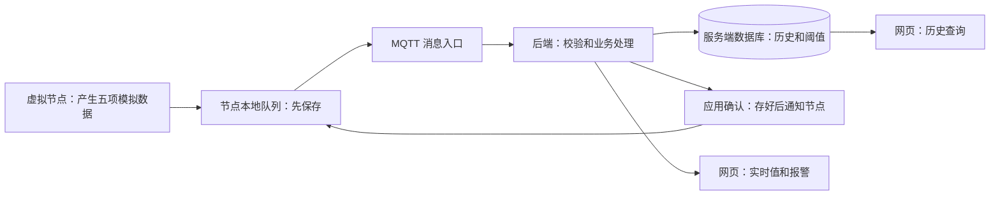
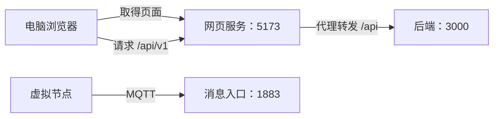
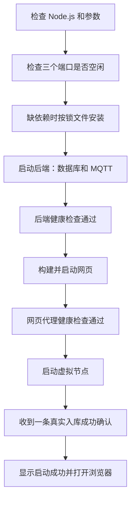
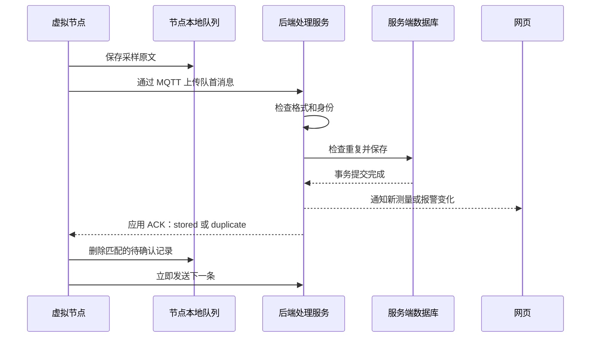
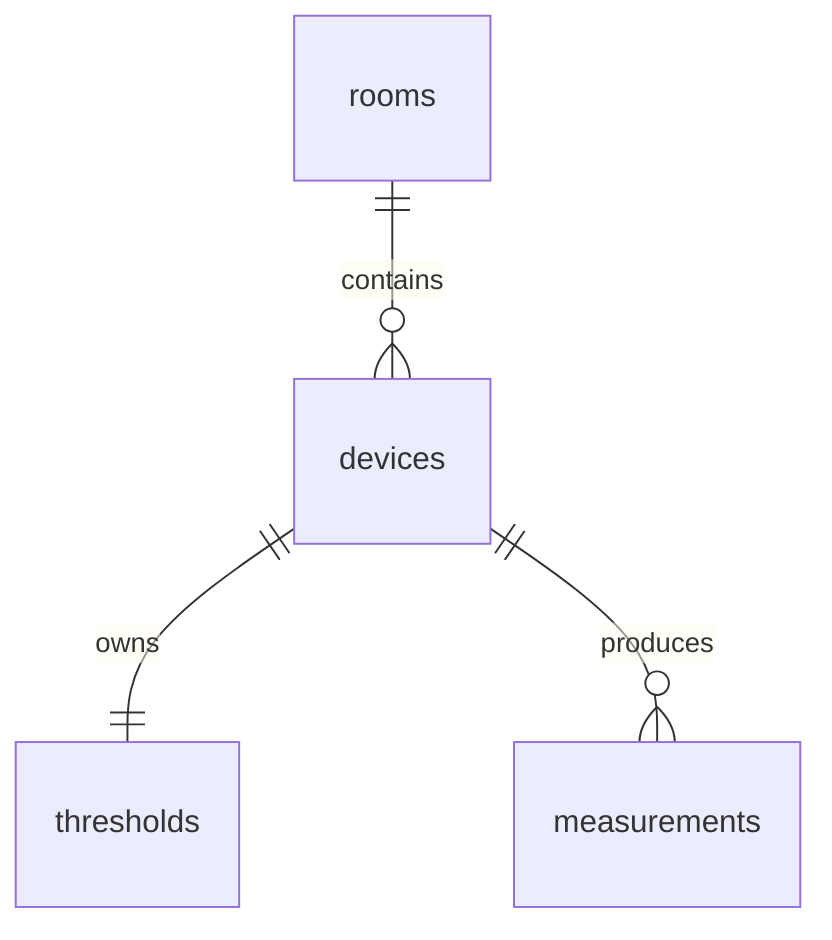
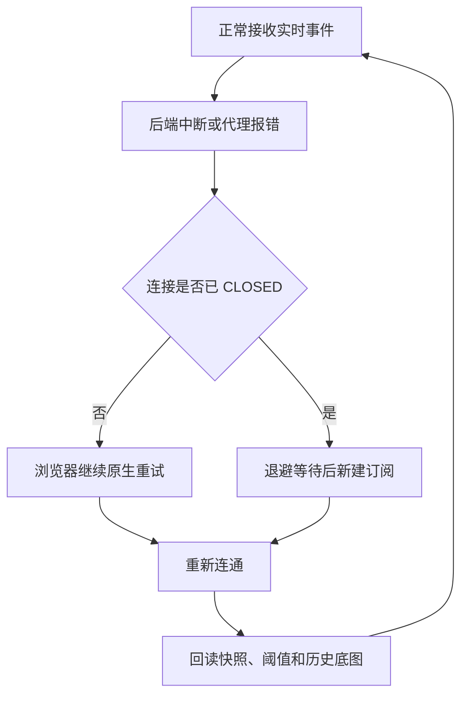
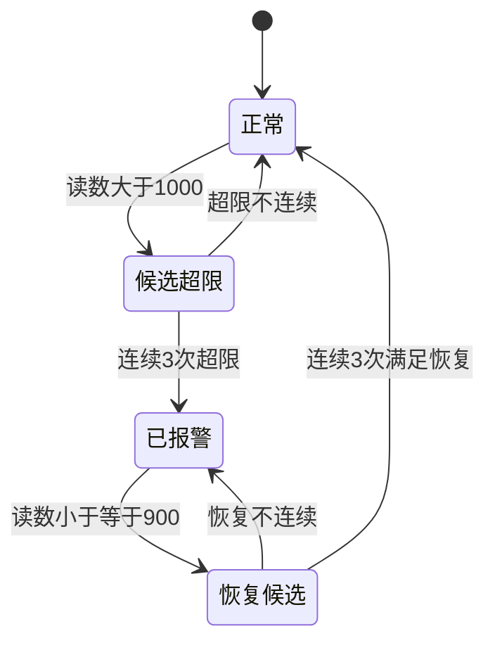
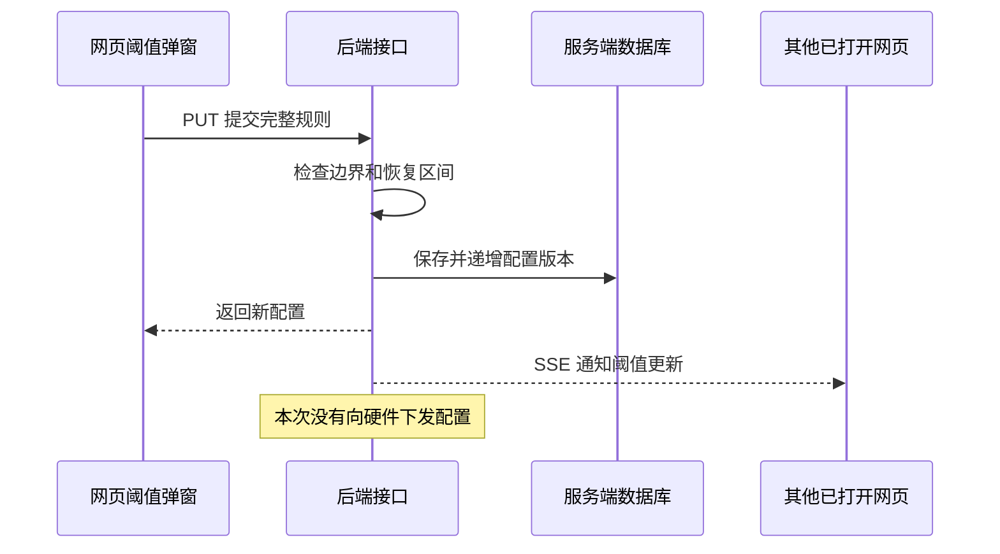
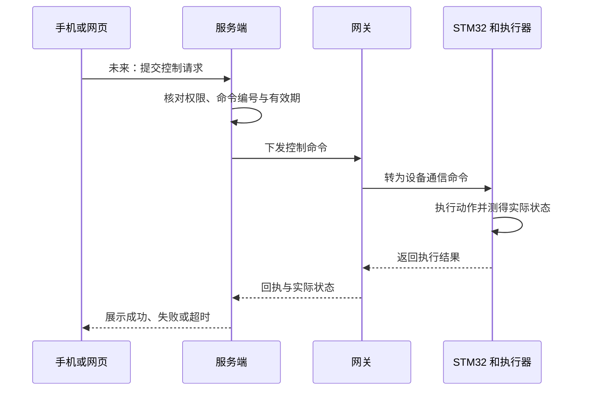

# 知境：教室环境监测项目，从零到完整理解

更新日期：2026-10-18。本文依据当前源码编写，解释已经实现的软件以及后续接硬件的位置。硬件接线、器件驱动和固件等实物到手后再补，不把计划写成完成结果。

## 0. 怎么读这份文档

这是一份项目教材，不是只列技术名称的介绍。建议边读边运行，先理解一条数据怎样到网页，再理解断线时为什么能补传。

**术语注释规则**：每章首次引入专业名词时，紧邻说明“是什么、为什么使用”；代码中的字段与函数在附近逐项解释。后面重复出现时用短解释或本章上下文，不要求先记住英文。末尾还有查阅表。

代码路径均相对于项目根目录。示例日期、序号和数值是讲解数据，不代表额外实测。图中的实线表示当前软件链路，注明“未来”的部分尚未实现。

推荐阅读路线：

| 阶段 | 阅读内容 | 读完应能完成的动作 |
| --- | --- | --- |
| 先会使用 | 第 1–5 章 | 启动、查看、查询、停止系统 |
| 看懂传输 | 第 6–11 章 | 解释数据格式、确认、去重与补传 |
| 看懂展示 | 第 12–16 章 | 解释实时状态、历史、报警和阈值 |
| 会查问题 | 第 17–21 章 | 对照源码定位故障、理解测试证据 |
| 转为自己的能力 | 第 22–25 章 | 画出全链路、动手改进、说明能力边界 |

## 1. 这个项目到底做了什么

项目名“知境”，目标是让人看到教室的温度、湿度、二氧化碳、粉尘估算值和光照变化，并在超出演示阈值时提醒。

当前是 **MVP（Minimum Viable Product，最小可用产品：先做可运行的核心功能；用于在真实传感器到手前验证软件方案）**。

目前使用 **虚拟节点（用程序代替实际采集设备；为了可重复地产生正常、超限和恢复数据）**，不是房间里真实传感器测量。

### 1.1 功能状态表

| 功能 | 当前状态 | 具体含义 |
| --- | --- | --- |
| 五项模拟环境数据 | 已实现 | 默认每 2 秒产生一条记录 |
| 数据上传与保存 | 已实现 | 通过消息通信进入电脑上的数据库 |
| 实时网页、历史曲线 | 已实现 | 浏览器查看当前值与一段时间内的变化 |
| 网页报警、阈值修改 | 已实现 | 服务端判断报警，网页显示并可修改服务端规则 |
| 断线缓存与重发 | 已实现于 PC 虚拟节点 | 未确认数据先存在本地，恢复后重发 |
| 手机尺寸网页布局 | 已实现并做浏览器尺寸测试 | 不等于手机已经能连到电脑 |
| Android 原生应用 | 未实现 | 没有可安装的 Android 应用包、手机工程或原生页面 |
| Android 手机通过局域网看网页 | 未配置、未实机验收 | 当前服务只接受电脑自己的连接 |
| 外网远程查看 | 未实现部署 | 没有公网服务地址、账号登录和访问控制 |
| 远程控制真实设备 | 未实现 | 没有控制命令、硬件执行、回执与实际状态反馈链路 |
| STM32、ESP8266 与真实传感器 | 待器件到手 | 尚未实现接线、驱动、烧录和实物联调 |

**重要区分**：网页改阈值属于“修改服务器如何判断报警”，不是“给硬件下发命令”。

### 1.2 五个指标是什么

| 显示指标 | 字段 | 旁注：是什么，为什么测 |
| --- | --- | --- |
| 温度 | `temperature_c` | 摄氏温度，单位 °C；用于观察冷热变化 |
| 相对湿度 | `humidity_rh` | 当前水汽相对同温度饱和状态的比例，单位 %RH；用于观察干湿变化 |
| CO₂ | `co2_ppm` | 二氧化碳浓度；ppm 是百万分之一的比例单位，用于描述这类气体浓度 |
| 粉尘浓度估算值 | `dust_ug_m3` | 单位 μg/m³，即每立方米空气中的微克数；预留给 GP2Y1010 输出换算 |
| 光照强度 | `illuminance_lux` | 单位 lx，勒克斯；用于观察环境明暗 |

**GP2Y1010（光学粉尘传感器型号；未来用其输出估算粉尘）不等于经标定的 PM2.5 测量仪。PM2.5（空气动力学直径不大于 2.5 微米的颗粒物这一分类）不是“所有粉尘”的另一个名字。** 因此代码没有把字段叫 `pm25_ug_m3`。

## 2. 先用一个生活类比理解全局

把系统想成“学生交作业”：

- 虚拟节点是学生，每两秒写一份带编号的作业。
- 消息服务像收件台，负责把作业送到处理老师。
- 后端像老师，检查格式、保存，再通知“已登记”。
- 节点的待确认队列像学生自己的备份，没收到登记确认前不扔。
- 网页像公示栏，展示最新登记结果。

类比的边界：电脑数据库的持久保存也有磁盘等故障条件，不能理解成任何情况下永不丢失。



**前端（运行在浏览器里的界面程序；为了让人操作和看图）** 与 **后端（运行在电脑上的服务程序；为了统一校验、存储和处理）** 是分工，不是一定在两台电脑上。

**数据库（按规则组织、查询并保存数据的系统；为了退出程序后仍保留历史）** 与网页中的临时变量也不是一回事。

## 3. 技术名词，先认识这一组

| 名词 | 是什么 | 为什么本项目用它 |
| --- | --- | --- |
| JavaScript | 本项目主要使用的编程语言 | 节点、服务和网页可复用一套语言思路 |
| Node.js | 在浏览器外运行 JavaScript 的运行环境 | 让电脑直接运行后端、模拟节点和启动脚本 |
| npm | 随 Node.js 配套的软件包和脚本管理工具 | 按清单安装依赖、运行测试与构建 |
| 依赖 | 项目需要使用的其他软件库 | 避免从头实现消息协议、网页框架等通用功能 |
| `package.json` | 每个子项目的配置清单 | 记录脚本命令、依赖和运行版本要求 |
| `package-lock.json` | 依赖的精确版本与来源记录 | 让不同电脑尽量安装相同的依赖组合 |
| ESM | JavaScript 的模块组织方式，使用 `import` / `export` | 把代码按职责拆文件，便于理解和维护 |
| Express | Node.js 的网页服务框架 | 接收浏览器请求，组织查询和设置接口 |
| Aedes | 在 Node.js 中运行的 MQTT 消息代理库 | 后端直接带消息入口，减少本机额外部署软件 |
| MQTT 3.1.1 | 按主题发布和订阅消息的通信协议及版本 | 让虚拟节点及未来设备按统一约定上传数据 |
| SQLite | 数据存在普通磁盘文件中的关系数据库 | 本机演示无需另装独立数据库服务 |
| `node:sqlite` | Node.js 自带的 SQLite 调用模块 | 本项目不再额外安装数据库驱动包 |
| Ajv | 按结构规则检查 JSON 数据的库 | 自动发现缺字段、错误类型和多余字段 |
| React | 根据界面状态生成网页内容的库 | 让数值、连接状态与弹窗随数据更新 |
| Vite | 网页开发、打包和预览工具 | 开发时方便调试，交付时生成可运行网页资源 |
| ECharts | 数据图表库 | 绘制实时与历史变化曲线 |
| Playwright | 自动操作浏览器的测试工具 | 检查点击、页面状态和连接恢复，而不只检查函数 |
| Git | 保存代码版本和变更历史的工具 | 将源码按提交记录管理 |
| GitHub | 托管 Git 仓库的网站 | 对外展示源码、文档及自动检查结果 |
| Markdown / `.md` | 用普通文本加标记写文档的格式 | 便于在 GitHub 中阅读、修改和追踪变化 |
| Mermaid | 在 Markdown 中用文字描述图形的语法 | 让流程图能与文字一起维护，不必截图改图 |

当前要求 Node.js `>=24.15.0 <25`、npm `>=11 <12`，以各子项目配置为准。**版本范围（允许哪些版本；用于避免运行环境不兼容）**不是越新越好，也不是装好任意 Node.js 就能运行。

## 4. 三个地址为什么不同

**IP 地址（网络上寻找主机的地址；用于找到运行服务的电脑）** 与 **端口（同一主机上区分服务的编号；用于区分网页、查询和消息入口）** 是两个层次。

| 地址 | 是什么 | 为什么存在 |
| --- | --- | --- |
| `http://127.0.0.1:5173` | 人打开的网页地址 | 浏览器从这里取得页面资源 |
| `http://127.0.0.1:3000/api/v1` | 后端接口前缀 | 提供查询、阈值设置及实时事件 |
| `mqtt://127.0.0.1:1883` | MQTT 消息连接地址 | 给节点上传数据使用，不是浏览器页面 |

**HTTP（浏览器和服务端交换请求、响应的协议；网页查询与设置使用它）** 与 MQTT 是不同的通信约定，所以不能把 MQTT 地址粘到地址栏期待出现看板。

**127.0.0.1 / 回环地址（永远表示发起连接的设备自己；本项目借此限制本机演示范围）**：

```text
电脑访问 127.0.0.1  → 电脑自己 → 可以找到本项目
手机访问 127.0.0.1  →手机自己 → 找不到电脑上的本项目
```

**局域网（例如同一家庭或学校网络内的设备网络）**查看至少需要网页监听电脑对外地址、电脑防火墙允许访问、设备之间网络可达。**0.0.0.0（服务监听所有本机网络接口的写法）**不是让用户在手机里访问的目标地址，也不会自动生成外网访问能力。

本项目的网页预览、后端和 MQTT 默认都监听 `127.0.0.1`；启动器也统一使用这个地址。仅在手机和电脑连接同一个 Wi-Fi，并不能自动访问。

**代理（网页服务替浏览器转发请求；为了统一请求入口）**在此项目中的位置：



网页代码调用 `/api/v1` 这样的相对路径，实际由 5173 的服务转发到 3000。**同源（协议、主机、端口均相同；浏览器用它界定页面与请求的来源关系）**因而更容易保持一致。

源码：[网页代理配置](../Projects/web/vite.config.js)、[网页运行入口](../scripts/web-runtime.mjs)、[后端配置](../Projects/server/src/config.js)。

## 5. 从启动到退出，程序做了什么

### 5.1 最简单的启动

在项目目录的 PowerShell（Windows 命令行环境；用于执行启动和检查命令）中运行：

```powershell
.\start.cmd --scenario demo --data-dir tmp/learning-demo
```

- `start.cmd`：Windows 的启动入口，转到真正的启动脚本。
- `--scenario demo`：参数，指定正常、超限、恢复的模拟场景。
- `--data-dir tmp/learning-demo`：指定独立学习数据目录，避免练习混进日常数据库。
- `--no-open`：另一个可选参数，表示启动后不自动打开浏览器。

**命令行参数（跟在命令后面的可选配置；用于改变一次运行的行为）**不是写进程序的新功能。

### 5.2 一键启动不是只打开网页



**健康检查（通过接口询问服务依赖是否可用；用于避免进程存在但功能不可用）**会检查数据库和 MQTT，不只判断窗口有没有打开。

**构建 / build（把网页源码转换为浏览器加载的资源；用于交付运行）**每次启动都会执行。生成的 `dist` 目录是产物，不是新的手写源码。

**进程（操作系统中一个运行的程序实例；这里用于把三端隔离运行）**之间通过 **IPC（Inter-Process Communication，电脑内部进程间通信；启动器借此请求停止、收到就绪或入库通知）**协作。IPC 不等于 MQTT，也不是未来设备上的通信方式。

### 5.3 安装与配置的细节

`npm ci`（严格根据锁文件安装依赖的命令；用于可重复安装）在缺依赖时由启动器执行，首次可能需要网络。

`.env`（本机环境变量配置文件；用于放运行参数而不改源码）不进入公开仓库；`.env.example` 是不含凭证的填写示例，可以公开。

启动器会统一覆盖三端的连接地址、设备身份、数据库路径与采样周期，但不改写 `.env`。单独运行子项目与使用一键启动器时，要留意配置来源不同。

### 5.4 正常退出

保留启动窗口，按 Ctrl+C。**正常停止（先处理正在进行的工作再关闭；为了保留队列并释放资源）**按“节点、网页、后端”处理。

节点保留未确认记录并尝试报告离线，后端关闭连接和数据库。Windows 若问 `Terminate batch job (Y/N)?`，输入 `Y` 结束批处理。

任一子进程异常退出，启动器会停止本次启动的其他服务。因此：**要做“后端停机但节点继续积压”的实验，应使用独立启动方式或整体联调脚本；直接杀掉一键启动下的后端会触发整组退出。**

源码：[启动器](../scripts/start.mjs)、[节点入口](../Projects/simulator/src/index.js)、[后端入口](../Projects/server/src/index.js)。

## 6. 一条数据长什么样

**JSON（用字段名和数据值表示结构化内容的文本格式；便于不同程序读写同一条采样）**是本项目上传的负载格式。

**负载 / payload（消息里真正的业务内容；这里就是采样 JSON）**不包含消息协议的主题等额外部分。

```json
{
  "schema_version": 1,
  "device_id": "classroom-001-node-001",
  "room_id": "classroom-001",
  "boot_id": "7c9a21f0",
  "seq": 1,
  "sampled_at": "2026-10-18T02:00:00.000Z",
  "source": "simulator",
  "metrics": {
    "temperature_c": 24.6,
    "humidity_rh": 48.2,
    "co2_ppm": 720,
    "dust_ug_m3": 28,
    "illuminance_lux": 430
  }
}
```

| 字段 | 是什么 | 为什么需要 |
| --- | --- | --- |
| `schema_version` | 消息结构版本，目前为 1 | 日后协议变化时避免旧程序误解新数据 |
| `device_id` | 设备身份 | 确定谁上传了这条数据 |
| `room_id` | 教室身份 | 确定数据属于哪个场所 |
| `boot_id` | 一次启动批次的身份 | 重启后序号可能从头开始，必须区分批次 |
| `seq` | 批次内递增的采样序号 | 识别消息与匹配确认 |
| `sampled_at` | 采样时间；未知时为 `null` | 保留断线前真正采样时刻 |
| `source` | 数据来源，`simulator` 或 `hardware` | 防止把模拟数据当成实测 |
| `metrics` | 五项指标的集合 | 统一每种指标的字段和单位 |

**null（明确表示没有有效值；用于缺测或未知时间）**不同于零。例如 CO₂ 为 0 是一个数值，不能偷偷拿它表示传感器坏了。

`NaN`（不是有效数字的特殊计算结果）与 `Infinity`（无穷大）不能作为本协议的 JSON 数字；必须在发送前处理。

**UTF-8（文本编码方式，即字符如何变成字节；用于保证两端理解同样的文本）**决定负载长度应按字节核算。1024 字节是应用负载上限，不是完整 MQTT 报文上限；主题和协议自身也占空间。

源码：[统一结构规则](contracts/telemetry.schema.json)、[节点消息检查](../Projects/simulator/src/contract.js)。

## 7. 虚拟节点怎样产生数据

**模拟器 / simulator（用程序复现设备行为；用于先验证通信与异常处理）**不只是不断输出随机数。

生成器使用 **随机种子（决定伪随机数序列起点的输入；用于重复相同趋势便于测试）**和持续变化的目标值，使数据缓慢接近正常或超限范围。

核心思路可以读成：

```text
新读数 = 旧读数 + (目标值 - 旧读数) × 0.32 + 少量波动
```

其中 0.32 是当前生成器的平滑系数，属于模拟数据生成方法，不是传感器标定参数。

| 场景参数 | 行为 |
| --- | --- |
| `normal` | 正常范围附近变化 |
| `co2_high` | CO₂ 目标值偏高 |
| `dust_high` | 粉尘估算值目标偏高 |
| `demo` | 40 个采样步骤组成一轮：10 步正常、15 步高值、15 步恢复 |

默认 2 秒一步，一轮约 80 秒，但读数是逐步接近目标的，不能认为第 20 秒报警必定立即出现。报警还有连续计数。

每次启动生成新 `boot_id`，新采样的 `seq` 从低值递增。旧队列保留旧批次和旧序号，不能改成新批次后再发送。

默认待发容量为 43,200 条。按 2 秒一条，设计上约等于 24 小时的新采样数量；**这不是完成过 24 小时稳定性测试的结论**。

容量满时，程序保留旧的待确认记录，停止接纳新采样；出队腾出空间后恢复。不能宣传为“离线无限时长不丢数据”。

源码：[生成器](../Projects/simulator/src/generator.js)、[采样和发送调度](../Projects/simulator/src/node.js)、[默认配置](../Projects/simulator/src/config.js)。

## 8. MQTT 怎样把数据送到后端

**发布 / publish（把消息送到一个主题；节点借此上传采样）**与 **订阅 / subscribe（请求接收某个主题的消息；节点借此接收入库确认）**是 MQTT 的基本动作。

**Broker（消息代理，接收并分发消息的服务；本项目由 Aedes 承担）**负责按 **topic（主题，类似消息的分类地址；用于将采样、确认和状态分开）**组织通信。

| 主题 | 谁发送 | 作用 |
| --- | --- | --- |
| `envmon/v1/devices/{device_id}/telemetry` | 节点 | 上传环境采样；telemetry 意为遥测，即设备向外报告测量数据 |
| `envmon/v1/devices/{device_id}/ack` | 后端 | 返回业务入库结果 |
| `envmon/v1/devices/{device_id}/status` | 节点 | 报告在线、离线等连接提示 |

`{device_id}` 是需要替换的占位文字，不是实际主题里保留大括号。默认设备应替换成 `classroom-001-node-001`。

**QoS 1（Quality of Service 的等级 1，至少一次交付语义；用于允许消息重试，但可能重复）**不能单独保证“业务只执行一次”。

**PUBACK（MQTT 对 QoS 1 发布的协议确认；用于完成协议交付流程）**与后文的数据库入库确认不是同一件事。

**SUBACK（订阅请求的协议确认；用于确定已经能够接收入库确认）**必须先拿到，节点才开始按序发数据。否则服务器快速回复时，节点可能还没订阅好确认主题。

**retain（代理为某主题保留最后一条消息的标记；状态主题使用它方便表达最近状态）**在采样与应用确认中禁止使用，避免新订阅者把旧消息当成刚刚发生的结果。

**遗嘱 / LWT（连接建立时预先登记的异常断线消息；节点借此表达掉线意图）**不能替代本项目后端对实际连接断开的跟踪，也不能证明采样仍新鲜。

源码：[MQTT 入口与规则](../Projects/server/src/mqtt.js)、[节点连接与订阅](../Projects/simulator/src/node.js)。

## 9. 最重要的一章：为什么要先存队列、再等确认

**outbox（待发送、待确认的本地记录集合；用于程序重启和断线后继续发送）**存放在节点自己的 SQLite 文件中。

**持久化（把数据写到关闭进程后仍能读取的存储；用于避免只存在内存里）**不等于无限可靠，仍依赖文件和磁盘可用。

**应用 ACK（业务层确认；此项目用来证明服务端已经完成数据库保存或确认该消息早已存在）**才决定节点能否清理队列。



**事务（把相关数据库操作组织成一起成功或一起撤回的工作单元；用于避免只完成一半）**在当前代码中先完成提交，再产生业务成功通知。

**COMMIT（提交事务，使这次修改成为成功结果）**之后才允许返回入库成功。**ROLLBACK（撤回失败事务的修改）**用于数据库操作出错时恢复一致状态。

网页事件与节点的应用确认都在提交之后产生；不能要求网页收到消息和节点收到确认在网络上严格谁先谁后。

### 9.1 一个最能说明问题的故障

```text
1. 节点发了第 8 条。
2. 后端把第 8 条存好了。
3. 回给节点的入库确认丢失。
4. 节点不知道已经存好，重发第 8 条。
5. 后端识别这是同一条，返回 duplicate。
6. 节点拿到确认，删除第 8 条。
```

`stored`（首次保存成功）、`duplicate`（相同消息已经保存过）、`rejected`（业务检查永久拒收）是三种应用处理结果，不是 MQTT 的三种交付等级。

永久拒收的消息会保留原因并改成拒收状态，之后继续处理后面的待发数据；不是把坏记录静默删除。数据库暂时失败时，后端不发成功 ACK，让节点保留记录等待重试。

### 9.2 为什么重试不会同时发很多份

**在途消息 / flight（已经发送、尚未结算的当前一条；用于控制顺序）**在本项目最多保持一条。`pump()` 是从队列取下一条的调度函数，已有在途消息时直接返回。

**超时（规定时间内未收到结果；用于识别可能丢失的确认）**默认 10 秒。**指数退避（失败越多，额外等待逐步加长；用于避免故障时持续密集重发）**从默认 1 秒起步，上限 30 秒。

这里的退避是 ACK 超时后的额外等待，不能把“10 秒确认等待”和“1 秒重试退避”混成一个参数。

**微任务 / queueMicrotask（当前同步处理结束后尽快执行的小任务；用于确认后立即推进下一条）**让补传不必等下一个 2 秒采样周期。

源码：[发送与确认状态机](../Projects/simulator/src/node.js)、[本地队列](../Projects/simulator/src/outbox.js)。

## 10. 什么叫幂等，为什么三个字段缺一不可

**幂等（同一个操作重复执行，业务结果不重复增加；此处为了应对网络重发）**通过消息身份和数据库检查实现。

```text
消息身份 = (device_id, boot_id, seq)
             设备      启动批次  序号

设备 A / 批次 X / 序号 1  ≠ 设备 B / 批次 X / 序号 1
设备 A / 批次 X / 序号 1  ≠ 设备 A / 批次 Y / 序号 1
设备 A / 批次 X / 序号 1  = 同一原始消息重发的身份
```

**唯一约束 / UNIQUE（数据库禁止某组字段组合重复出现；用于从存储层兜住重复数据）**规定上述三字段联合唯一。

仅仅“身份一样”还不够。程序还比对 **规范化内容 / canonical JSON（将对象字段按固定顺序表达的文本；用于忽略空白和字段顺序差异，真正比较业务内容）**：

| 情况 | 处理 |
| --- | --- |
| 身份未出现 | 保存，返回 `stored` |
| 身份相同、内容相同 | 不重复插入，返回 `duplicate` |
| 身份相同、内容不同 | 拒收，错误码 `MESSAGE_CONFLICT`，表示同一个编号被用于不同内容 |

**exactly once（端到端恰好一次的交付或执行目标）**不能作为本项目无条件保证。准确表达是“至少一次重试 + 幂等入库”，且有队列容量与持久存储等条件。

源码：[内容规范化](../Projects/server/src/validation.js)、[唯一键与去重事务](../Projects/server/src/db.js)。

## 11. 后端的几道检查与数据库

### 11.1 为什么不能收到什么就保存什么

**JSON Schema（描述字段、类型、范围与必填规则的结构规范；用于统一三端的数据约定）**由 Ajv 执行检查。

检查依次包括：字节数不超限、文本能解码、JSON 能解析、主题正确、使用 QoS 1、不使用 retained 采样、数据结构正确、设备与教室匹配、时间不过分超前。

**身份校验（核对主题身份、消息身份与已登记信息是否一致；用于避免串教室、串设备）**不等于 **身份认证（证明连接者真的拥有这个设备身份；用于限制冒充）**。当前并没有设备密码或证书认证。

**白名单（只允许事先列出的值；用于防止任意字段进入动态查询）**限制历史查询只能选择五个已知指标。

### 11.2 服务端实际只有这四张业务表

**表（数据库里按行列保存同类对象的结构；为了按职责组织数据）**与项目文件夹不是同一个概念。



图例：`rooms` 为教室，`devices` 为设备，`thresholds` 为阈值配置，`measurements` 为测量记录。图中的“一对多”表示一个教室可关联设备记录，但当前演示只配置一个教室和一个设备。

| 表 | 保存什么 | 为什么单独保存 |
| --- | --- | --- |
| `rooms` | 教室身份 | 让设备归属有明确依据 |
| `devices` | 设备身份与教室归属 | 校验上传数据来自哪个登记对象 |
| `thresholds` | 每设备一份报警规则及版本 | 退出再启动后保留设置 |
| `measurements` | 原消息、时间、指标与唯一身份 | 查询历史、核对去重、恢复最新快照 |

节点的另一个数据库有 `outbox` 表，它属于“发送端”，不能和服务端 `measurements` 混淆。

**主键 / PRIMARY KEY（区分每一行的唯一编号；用于定位记录）**、**外键 / REFERENCES（约束一条记录引用的对象必须存在；用于保持设备归属关系）**、**索引 / INDEX（帮助按常用条件定位记录的辅助结构；用于加快设备和时间查询）**各有职责。

**SQL（数据库查询与修改语言；用于建表、插入、筛选和聚合）**中的 `SELECT` 是查询，`INSERT` 是新增，`UPDATE` 是修改，`DELETE` 是删除。

**参数化查询（把数据值单独传给 SQL，而不把值直接拼进语句；用于避免输入被当成查询指令）**在这里使用 `?` 占位。指标列名属于结构，不能用同样方式绑定，所以还需要白名单。

**WAL（Write-Ahead Logging，SQLite 先写日志再整理主文件的工作方式；用于组织持久写入并改善读写配合）**会产生 `-wal`、`-shm` 辅助文件。`synchronous=FULL`（要求更严格的写入同步；用于加强持久性）也不是磁盘损坏下的绝对保证。

数据库路径：

```text
Projects/server/data/environment.sqlite    历史与阈值
Projects/simulator/data/outbox.sqlite      节点未确认队列
```

备份前正常停止系统，再处理整个数据库相关文件；不要把正在变化的主文件随意复制后认为已有一致备份。

源码：[建表与数据库操作](../Projects/server/src/db.js)、[消息校验](../Projects/server/src/validation.js)。

## 12. 时间为什么要分四种

**UTC（统一的世界时间基准；用于不同设备之间可比较地存时间）**在本项目字符串中通常以末尾 `Z` 表示。

**RFC 3339（带时区的日期时间书写规范；用于避免各端对时间字符串有不同理解）**让 `2026-10-18T02:00:00.000Z` 表示一个确定时刻。

| 时间字段 | 含义 | 为什么分开 |
| --- | --- | --- |
| `sampled_at` | 节点实际采样时刻 | 断线补传也应回到原采样位置 |
| `received_at` | 服务器收到并处理消息的时刻 | 观察传输与补传发生时间 |
| `stored_at` | 本次记录写入时使用的服务端时间 | 标记保存记录的服务端时刻；不是精确磁盘刷写完成计时 |
| `effective_at` | 系统用于排序与查询的有效时间 | 有采样时间用采样时间，否则用接收时间 |

**时间质量 / time_quality（标记排序时间是否真来自已知采样时刻；用于区别测量与接收推定）**只有当前两种：

- `device`：具有有效的设备采样时间。
- `received_only`：采样时间未知，只能采用接收时刻组织记录。

未知采样时间的记录可以保存，但不参与宣称按真实采样时间绘制的历史曲线，也不作为新鲜采样推动报警。

后端允许保存旧采样，以便补传，但超过当前时间 5 秒的采样会拒收，防止错误校时造成未来记录。

网页按**浏览器本地时区（浏览器所在系统的时间显示习惯；用于让使用者看懂时刻）**显示。当前代码没有强制把所有浏览器固定成 Asia/Shanghai，电脑在上海时区时看起来才是北京时间。

源码：[时间校验](../Projects/server/src/validation.js)、[有效时间](../Projects/server/src/db.js)、[网页时间格式](../Projects/web/src/metrics.js)。

## 13. REST 与 SSE 怎样分工

**API（Application Programming Interface，程序间约定的调用入口；为了让网页不直接读数据库）**在本项目以 HTTP 路由提供。

**REST（以资源地址和 HTTP 方法组织查询、修改的接口风格；用于最新值、历史与阈值设置）**不代表网页只能定时刷新。

**GET（读取资源的 HTTP 方法；用于查询）**与 **PUT（提交替换配置的 HTTP 方法；用于保存阈值）**表达不同操作。

以下地址都带 `/api/v1` 前缀：

| 方法与路径 | 当前作用 |
| --- | --- |
| `GET /health` | 检查数据库及 MQTT 状态 |
| `GET /devices/{deviceId}/latest` | 获取最新快照、设备状态与当前报警 |
| `GET /devices/{deviceId}/series` | 获取某指标的历史时间桶 |
| `GET /devices/{deviceId}/thresholds` | 获取当前阈值 |
| `PUT /devices/{deviceId}/thresholds` | 保存完整阈值配置 |
| `GET /events?device_id=...` | 建立指定设备的实时事件订阅 |

**快照 / snapshot（一次查询时服务器的完整当前状态；用于首次加载与断线后恢复）**与 **增量事件（告诉页面刚刚发生某项变化；用于实时更新）**配合。

**SSE（Server-Sent Events，服务端通过一条持续的 HTTP 响应向浏览器推送事件；用于本项目单向实时通知）**由浏览器的 **EventSource（接收 SSE 的内置对象；用于维护订阅与连接状态）**接收。

| 事件名 | 是什么变化 | 网页为什么关心 |
| --- | --- | --- |
| `measurement.created` | 新测量保存成功 | 更新读数与曲线 |
| `device.updated` | 设备连接或过期状态变化 | 显示离线、新鲜度等提示 |
| `alarm.changed` | 当前报警发生变化 | 显示超限或恢复 |
| `thresholds.updated` | 规则版本变化 | 同步其他页面看到的配置 |

**心跳 / heartbeat（连接空闲时仍发的轻量内容；用于维持和观察长连接）**在 SSE 中默认每 15 秒发送一次注释行，不是环境采样。

SSE 只负责服务端向网页推送，本项目没有借此给设备发控制命令。**WebSocket（可在一个连接中双向传消息的协议）**当前未采用；不能在简历里把 SSE 写成 WebSocket。

源码：[HTTP 路由](../Projects/server/src/http.js)、[SSE 分发](../Projects/server/src/events.js)、[网页接口封装](../Projects/web/src/api.js)。

## 14. 网页怎样避免旧数据盖住新数据

**React 状态 / state（决定界面显示内容的当前数据；用于随请求和事件更新页面）**由 `useMonitoring` 集中管理。

**Hook（React 用于组合状态、订阅和生命周期逻辑的函数；这里把数据同步从页面样式中分离）**不是后端接口。

主要状态有：最近一条测量、设备状态、报警数组、阈值配置、连接状态、近期曲线记录。

**竞态 / race（多个异步结果到达顺序不同而影响结果；这里可能让旧查询覆盖新事件）**举例：

```text
时刻 1：网页发出查询 A，查到“旧阈值”。
时刻 2：服务端保存新阈值，网页先收到实时事件 B。
时刻 3：查询 A 的响应才到达。
如果不比较版本，页面会把新阈值改回旧阈值。
```

代码用配置版本、事件计数和当前有效时间处理类似问题：

- `newest()`（选择更新记录的函数；避免历史补传让卡片倒退）先比较有效时间，同时间再比较记录编号。
- `version`（服务端递增的配置版本；避免旧配置响应覆盖新配置）用于阈值合并。
- 修订计数用于辨别请求发出后是否已经收到更晚的设备或报警事件。
- 先建立实时订阅，再查询快照；两者配合减少加载期间的变化遗漏。

**AbortController（可取消正在等待的浏览器请求的对象；用于切换条件或离开页面时停止旧请求）**和 **清理函数（订阅不再使用时释放连接、定时器的处理；用于防止重复连接和旧任务写入）**共同约束页面生命周期。

### 14.1 在线不等于新鲜

**在线 / online（当前有相应设备消息连接；用于描述通信状态）**与 **过期 / stale（最近有效采样距当前已超时；用于描述数据质量）**分开计算。

默认 10 秒没有新鲜有效采样，数据就过期。仅仅重新连上服务器、收到一条旧补传，不能证明环境值刚被测量。

### 14.2 后端重启后网页为什么能回来

EventSource 的 `CONNECTING`（仍在尝试连接）可继续利用浏览器原生重试；`CLOSED`（连接已停止）需要创建新的订阅。

网页对 CLOSED 按 1 秒起步、上限 15 秒退避重建，并在重新连接后回读快照、阈值、历史底图。服务端不提供“所有错过事件逐条重播”的完整事件日志，恢复主要依靠重新查询。



**代理报错 500 / 502（请求经过的服务未能正常处理或转发；用于解释本机网页仍开着但后端已不可用）**是这次专门修复连接恢复的原因之一。

源码：[数据同步 Hook](../Projects/web/src/useMonitoring.js)、[记录合并](../Projects/web/src/model.js)。

## 15. 历史曲线为什么不是每条原始数据都画出来

**聚合（把多条数据按规则合并计算；为了避免长时间范围产生太多图点）**在后端完成。

**时间桶 / bucket（连续时间范围中的一个小分段；用于将该段样本合并成一个点）**中计算均值与有效样本数。

例如下面是教学数据，不是新增实测：

```text
时间桶 A：2 个值，700、900       → 均值 800，count=2
时间桶 B：1 个值，1100         → 均值 1100，count=1

全部样本均值 = (800×2 + 1100×1) / 3 = 900
直接平均桶均值 = (800+1100)/2 = 950    ← 样本数不同，含义不一致
```

**加权平均（按各组有效样本数量计算总体均值；这里用于验收脚本核对聚合是否正确）**不是当前网页额外提供的统计卡片功能。

当前历史接口最大查询范围 7 天，`max_points`（希望最多返回多少聚合点的参数；用于控制数据量）允许 1–1200，网页请求 600。

桶宽的计算：

```text
bucket_seconds = max(2, ceil(查询跨度毫秒 / (max_points × 1000)))
```

`ceil` 是向上取整，为了确保桶数不超出请求预算；`max` 是取较大值，这里保证最小桶宽 2 秒。时间桶相对于本次查询起点划分，不一定对齐自然分钟。

**左闭右开范围 `[start, end)`（包含起点、不包含终点；用于相邻查询避免边界重复）**在 SQL 条件中体现为 `>= start` 和 `< end`。

`AVG`（数据库均值计算）与 `COUNT(指标列)`（统计该列非空值数量）不会把缺测 null 当成 0。只有已知设备采样时间的记录进入曲线。

网页展示时间桶均值曲线、有效聚合点数量与桶宽；接口的 `count` 仍可用于核对，但页面没有展示每桶原始样本数列表。

源码：[历史 SQL](../Projects/server/src/db.js)、[范围与桶宽](../Projects/server/src/validation.js)、[历史页面](../Projects/web/src/components/HistoryView.jsx)。

## 16. 报警、恢复与阈值修改

### 16.1 超过一次为什么不立刻报警

**阈值（触发规则的边界；用于定义哪些演示数值需要提醒）**配合 **连续样本确认（多次有效采样都满足条件才改变状态；用于减少瞬时波动误报）**。

**迟滞 / hysteresis（触发与恢复使用不同边界；用于避免阈值附近来回报警）**以默认 CO₂ 为例：



这是便于理解的状态示意，不是额外一份固件实现。`consecutive_samples`（连续确认次数配置；用于统一触发与恢复的计数要求）默认 3。

| 指标 | 默认下限 | 默认上限 | 迟滞值 |
| --- | --- | --- | --- |
| 温度 | 16 °C | 30 °C | 1 °C |
| 相对湿度 | 30 %RH | 70 %RH | 3 个百分点 |
| CO₂ | 不设置 | 1000 ppm | 100 ppm |
| 粉尘估算值 | 不设置 | 100 μg/m³ | 10 μg/m³ |
| 光照 | 200 lx | 不设置 | 20 lx |

这些是工程演示规则，不是宣称通过空气质量标准评价。更改过数据库阈值后，当前运行值应以接口回读为准，不一定仍是默认值。

低限报警的恢复边界为“下限 + 迟滞”，例如光照低于 200 触发后，要达到 220 或更高并连续满足恢复次数。

### 16.2 哪些样本不能推动报警

- 缺测值不当作正常，也不累计恢复。
- 采样时间未知、明显过期或不按更新顺序到达的记录不用于当前报警计数。
- 连续样本之间若相隔太久，连续候选计数需要重置。
- 历史补传可以保存，但不能把十分钟前的高 CO₂ 当成当前突然超限。

默认 2 秒采样，第一次到第三次有效超限跨约 4 秒，这只是采样周期的算术结果，不是实测端到端报警延迟。

### 16.3 阈值从网页改到哪里



界面可编辑启用开关、上下限；连续次数和迟滞沿用服务端配置，界面并非完整规则编辑器。提交时不带旧 `version`，服务端生成新版本。

**内存（程序运行时临时保存状态的空间；读取快但进程退出后消失）**保存当前报警与计数；数据库保存历史与阈值。服务端重启后历史和阈值保留，活动报警从后续新鲜采样重新判断。

当前没有报警事件历史表或历史报警页面。

源码：[报警状态处理](../Projects/server/src/alarms.js)、[默认规则](../Projects/server/src/config.js)、[阈值弹窗](../Projects/web/src/components/ThresholdDialog.jsx)。

## 17. 按职责读源码，不要从第一行一路硬背

**入口（程序开始执行的文件；用于找到启动后的第一步）**、**模块（围绕一个职责组织的文件；用于降低阅读和修改范围）**是找代码的基本方法。

| 阅读顺序 | 文件 | 输入、处理、输出 |
| --- | --- | --- |
| 1 | `scripts/start.mjs` | 参数和环境 → 启动检查 → 三端就绪 |
| 2 | `Projects/simulator/src/index.js` | 配置 → 创建队列和节点 → 开始运行 |
| 3 | `Projects/simulator/src/generator.js` | 场景和种子 → 生成趋势 → 采样对象 |
| 4 | `Projects/simulator/src/outbox.js` | 采样对象 → 本地保存与结算 → 队首记录 |
| 5 | `Projects/simulator/src/node.js` | 队首记录和 ACK → 发送、重试、出队 → 下条消息 |
| 6 | `Projects/server/src/app.js` | 配置 → 组装数据库、服务、消息与网页接口 → 可运行后端 |
| 7 | `Projects/server/src/mqtt.js` | MQTT 报文 → 解码、入口限制、调用业务 → 应用确认 |
| 8 | `Projects/server/src/validation.js` | 用户或节点输入 → 检查规则 → 合法对象或错误 |
| 9 | `Projects/server/src/service.js` | 合法采样 → 入库与状态协调 → ACK 和实时事件 |
| 10 | `Projects/server/src/db.js` | 业务对象和查询条件 → SQL 事务与查询 → 记录、桶与规则 |
| 11 | `Projects/server/src/alarms.js` | 新鲜采样和阈值 → 连续计数、迟滞 → 当前报警 |
| 12 | `Projects/server/src/http.js`、`events.js` | HTTP 请求 / 业务事件 → 查询或分发 → 网页响应 |
| 13 | `Projects/web/src/api.js` | 页面需求 → HTTP 调用 → 数据或错误 |
| 14 | `Projects/web/src/useMonitoring.js`、`model.js` | 查询与 SSE → 合并、恢复、选择最新 → 页面状态 |
| 15 | `Projects/web/src/App.jsx`、`components/` | 状态与操作 → 页面、图表、弹窗 → 人看到的结果 |

**`.js` / `.mjs`（JavaScript 文件扩展名；后者明确表示模块文件）**和 **`.jsx`（允许在 JavaScript 中描述界面结构的文件；React 页面使用）**都是源码，不是需要双击打开的安装程序。

阅读任意函数，先回答四件事：谁调用它、拿到什么、改了什么、失败时怎样。能用中文讲清这四件事，比背依赖版本更有用。

### 17.1 三段关键代码的中文翻译

```javascript
if (this.stopping || !this.ready || !this.client?.connected || this.flight) return;
```

解释：准备退出、尚未订阅好确认、连接不存在或已经有一条在途消息时，就不发下一条。`?.` 是**可选链（对象不存在时停止继续读取；为了避免空对象访问报错）**。

```javascript
if (existing.content !== content) throw new InputError('MESSAGE_CONFLICT', ...);
```

这是省略错误说明参数后的阅读片段：同一个消息身份对应不同内容，抛出冲突错误。**异常 / throw（把无法正常处理的情况交给上层；用于让错误走明确的拒收流程）**不能理解为“继续存一份”。

```javascript
if (newer && device.alarms.sample(record, now)) {
  this.events.send('alarm.changed', { device_id: topicDevice, alarms: device.alarms.alarms() });
}
```

解释：只有比当前记录更新，并且报警集合确实变化，才发报警变化事件。报警函数内部还检查时间质量、过期与连续样本。**短路判断（前面条件不成立就不继续执行后面表达式；用于限制副作用）**是 `&&` 在此处的重要作用。

## 18. 怎样亲自验证，而不是只相信说明

**单元测试（针对较小逻辑的自动检查；用于快速定位规则问题）**、**集成测试（把多个模块或实际服务连起来；用于验证接口协作）**与 **端到端测试（从实际输入一路检查到用户页面；用于验证整体闭环）**覆盖的对象不同。

### 18.1 先检查环境

```powershell
node --version
npm --version
```

看到版本符合第 3 章范围，再运行安装和验证。不要在主系统运行时随意重装依赖。

### 18.2 基础验证

```powershell
npm --prefix Projects/server test
npm --prefix Projects/simulator test
npm --prefix Projects/web test
npm --prefix Projects/web run build
```

`--prefix`（指定在哪个子项目执行 npm；用于不反复切换目录）不是网络代理配置。

### 18.3 浏览器与整体联调

```powershell
npm --prefix Projects/web run test:browser
npm --prefix Projects/web run test:preview
node scripts/verify-system.mjs
```

浏览器验证需要本机 Chrome；安装位置不同可通过 `CHROME_PATH`（指定浏览器可执行文件位置的环境变量；用于让测试找到浏览器）配置。依赖应先安装，生产预览测试前应先完成网页构建。

整体脚本用独立端口和 `tmp` 下的测试数据库，不写日常历史库。**故障注入（主动制造丢确认、停机、强杀等情况；用于证明恢复机制）**比只观察正常看板更能检验可靠性。

### 18.4 已有记录能够证明什么

2026-10-16 验收记录：后端 17/17、节点 4/4、网页数据检查 4/4、浏览器 11/11、生产预览 1/1、整体联调 10/10 组，网页构建成功。

其中一次受控故障恢复保留并补传了 50 条积压原文，队列清零；丢一次 ACK 后确认重复但未重复入库。

这些是既有验收记录，不是说你已经亲自执行，也不是本篇文档重新执行过所有检查。不同粒度不应加成一个夸大的总测试数；没有据此得到真实传感器精度、外网手机效果或长期稳定性结论。

源码与证据：[整体联调脚本](../scripts/verify-system.mjs)、[既有验收记录](三端联调验收记录.md)。

## 19. 常见故障，先看现象再查链路

| 现象 | 可能原因 | 优先检查 |
| --- | --- | --- |
| 启动立即报端口占用 | 旧进程占用同一服务入口 | 启动错误信息；先正常停止旧服务，或指定其他端口 |
| 页面打开但一直连接中 | 后端未就绪，或网页代理不可达 | `/api/v1/health`、启动器日志、后端日志 |
| 节点一直等确认 | 订阅未完成、消息被拒、存储暂时失败 | 节点 ACK 订阅日志，后端拒收与数据库错误 |
| 队列不断增加 | 后端离线，或发送速度跟不上产生速度 | MQTT 连接、应用确认、拒收与容量日志 |
| 页面有旧值但提示过期 | 设备无新鲜采样 | 采样时间、节点状态、是否只在补传旧记录 |
| 历史没有曲线 | 时间范围、指标不对，或者时间未知 / 缺测 | 查询条件，`time_quality`，数据库原记录 |
| 阈值保存失败 | 上下限颠倒，或迟滞后没有恢复区间 | 弹窗错误、后端校验信息 |
| 重启后没有立即显示旧报警 | 当前报警只在内存中 | 等新鲜采样重新判断，不把它误认为阈值丢失 |
| 手机打不开 | 服务绑定回环地址，或网络隔离 | 第 4 章；当前并未交付局域网手机接入 |

**日志 / log（按时间记录程序行为的文本；用于还原错误发生顺序）**在启动器下位于 `tmp/runtime/运行批次/`。看最后一行通常不够，要找第一处失败及其前后的连接、采样和确认。

**错误码（固定的机器可识别错误名称；用于比自然语言提示更稳定地判断原因）**例如 `INVALID_PAYLOAD` 是负载不合法，`IDENTITY_MISMATCH` 是身份信息不一致，`MESSAGE_CONFLICT` 是同一编号内容冲突，`DEPENDENCY_UNAVAILABLE` 是依赖不可用。

排查顺序：环境和端口、后端健康、节点采样、入队、发送、数据库、应用确认、网页请求与事件。不要一看到网页不动就改图表代码。

## 20. Android 查看与远程控制：还缺哪些环节

### 20.1 三件容易混淆的事

**响应式网页（同一网页按屏幕宽度改变布局；用于让窄屏更易看）**已经实现。**原生 Android 应用（专门为 Android 系统构建安装的程序；用于手机平台专属体验）**没有实现。

**APK（Android 应用安装包；用于安装原生应用）**、**Android 工程（包含手机端代码、构建和权限配置的项目）**当前均不存在。

浏览器 390 像素宽度测试，只证明窄屏布局通过相应用例；不证明真实 Android 设备、Android 浏览器版本和网络链路均已验证。

### 20.2 三条查看路线的差异

| 路线 | 要增加什么 | 能做到什么 |
| --- | --- | --- |
| 手机浏览器，同一局域网 | 调整网页服务监听、网络访问与防火墙，再实机验证 | 手机不装 App，直接看网页 |
| 手机浏览器，跨网络 | 可访问部署、身份认证、加密传输、网络和长连接配置 | 在电脑所在网络之外查看 |
| 原生 Android App | 单独开发移动端页面、接口调用、实时订阅、权限和错误恢复 | 提供可安装的手机程序 |

**防火墙（限制哪些网络连接可进入电脑的机制；用于控制访问范围）**、**TLS / HTTPS（对通信加密并验证服务身份的机制；用于在开放网络中保护连接）**、**访问控制（限制谁能读、改或发指令；用于避免所有人都能操作）**是部署问题，不靠换一个手机页面自动解决。

当前没有为这些路线完成部署。本次整理不会擅自把无账号本机服务开放到公网。

### 20.3 为什么改阈值不是遥控设备

**执行器 / actuator（接到指令后改变物理状态的器件，例如继电器、风扇；用于执行控制动作）**与传感器是相反方向：前者动作，后者报告测量。

完整远程控制至少要有下列未来链路：



**命令编号（控制请求的唯一身份；用于识别重复指令）**、**有效期（过时后不再执行；用于避免旧命令补发造成错误动作）**、**执行回执（设备反馈实际处理结果；用于区分服务收到与硬件执行成功）**都尚未在当前业务中实现。

当前 MQTT 上传只使用采样、状态和应用确认主题；当前网页接口没有执行器控制入口。不能把采样 ACK 当作控制回执。

**本地声光报警（节点根据规则自行亮灯或响铃）**也与远程遥控不同；当前实体声光报警仍待硬件阶段。

源码核对入口：[现有全部 HTTP 路由](../Projects/server/src/http.js)、[现有消息主题](../Projects/server/src/mqtt.js)、[网页功能](../Projects/web/src/App.jsx)。

## 21. GitHub 里放什么，为什么不把电脑目录全塞进去

**仓库 / repository（代码及其版本历史的集合；用于协作和展示）**保存能重建项目的源文件，不必保存已经安装出来的全部依赖。

| 保留并上传 | 默认只留本机 | 原因 |
| --- | --- | --- |
| 源码、锁文件、协议、公开文档 | `node_modules` | 依赖能按锁文件重新安装，体积也大 |
| 安全的 `.env.example` | `.env` | 真实配置可能含地址、凭证或个人信息 |
| 截图与开题 PPT | 数据库、运行日志 | 避免把日常数据和临时故障文件公开 |
| 自动检查配置 | 缓存与构建产物 | 能重新生成，不应混进手写源码 |
| 本学习文档 | 原始带身份信息附件、个人求职稿 | 公开技术资料与个人材料分开 |

**`.gitignore`（告诉 Git 哪些未跟踪文件通常不纳入版本管理；用于排除依赖和本机数据）**不是对已经公开文件的自动撤回机制。

**提交 / commit（一次可回查的版本记录；用于描述这次加入了什么）**与 **推送 / push（把本地提交送到远程仓库；用于让 GitHub 上可见）**不是同一步。

**CI（Continuous Integration，提交后自动安装并检查代码的流程；用于发现新环境中的失败）**在本项目由 **GitHub Actions（GitHub 执行自动任务的功能；用于运行三个子项目检查）**提供配置。

当前工作流仅包含依赖安装、三个子项目的 `npm test` 与网页构建；不等于已经在云端跑过真实硬件或全部浏览器联调。云端结论以实际工作流结果为准。

源码：[发布说明](GitHub发布说明.md)、[导出脚本](../scripts/export-github-package.mjs)、[CI 配置](../.github/workflows/ci.yml)。

## 22. 器件到手后怎样接入，先理解边界

本章只解释衔接位置，不提供未经实物核实的接线图。

**MCU（Microcontroller Unit，微控制器，把计算与外设控制集成的芯片；未来负责采集与本地报警）**拟使用 STM32F103C8T6。**固件 / firmware（在板上运行的程序；用于操作传感器和通信）**当前尚未加入仓库。

**UART（异步串行通信接口；未来用于 STM32 和网关逐字节交换数据）**、**I²C（带时钟线和数据线的数字总线；未来用于读取 BH1750）**、**ADC（Analog-to-Digital Converter，将模拟电压转换成数字读数的外设；未来用于 GP2Y1010 输出）**属于设备端接口，不能与 MQTT 主题混淆。

**GPIO（General-Purpose Input/Output，通用输入输出引脚；未来控制 LED 和报警输出）**也不是电脑的 USB 端口。

```text
当前：生成器 → JavaScript 采样对象 → PC 本地队列 → MQTT → 现有后端
未来：传感器 → STM32 采样/换算 → UART → ESP8266 缓存/上传 → 现有后端
```

**网关（连接不同通信环节的中间设备；未来把串口采样转为网络消息）**拟用 ESP8266，通过 **Wi-Fi（无线局域网连接方式；用于联网）**接近真实使用场景。

要保留的约定：五指标单位、缺测 null、消息身份、原采样时间、应用确认后结算、重复内容检测。

需要重新实现的部分：采集驱动、串口帧解析、板端存储、网络恢复、本地报警和供电异常处理。

**RAM（运行时内存；速度快但失电即丢）**队列只能保证进程持续运行时缓存；**Flash（断电后仍保存内容的存储；需要评估容量和写入寿命）**等介质才可能支撑板端断电恢复。不能把 PC 的 SQLite 代码直接烧到 ESP8266，就认为固件已经完成。

节点没校时可以上传 `sampled_at: null`，并明确时间未知，不能假装知道精确采样时刻。硬件也不能连接电脑的 `127.0.0.1`；网络目标需要在硬件接入阶段单独配置。

## 23. 逐步练习：把“看过”变成“能解释、能修改”

### 第一轮：完全不改代码

1. 使用独立学习数据库启动 demo。
2. 找出网页显示的五个字段及单位。
3. 打开健康检查与最新值接口，解释返回内容。
4. 观察正常、超限、恢复，说明为什么不会每个波动都切换报警。
5. 修改一个服务端阈值，刷新回读；说明为什么这还不是硬件遥控。
6. 正常停止再启动，检查历史和阈值保留。

### 第二轮：追踪一条真实消息

记下同一条的 `device_id + boot_id + seq`，在节点日志、数据库或接口结果中找它。解释采样、接收、保存时间为什么不同。不要为了观察而直接篡改正在使用的数据库。

### 第三轮：验证恢复

先阅读 `verify-system.mjs` 中故障段，再运行整体联调。检查“丢 ACK 后重复识别”和“强杀重启后原文补传”分别验证了什么。

**断言 / assertion（程序对必须成立条件的检查；测试借此在错误出现时停止）**应围绕用户看得到的结果或协议保证，不只是证明某个函数被调用。

### 第四轮：做一个自己真正能解释的小改动

按嵌入式方向，可在后续另建练习模块实现 **C（常用于嵌入式的编译型语言；用于练习固定内存和设备协议处理）**版本的采样编码或确认状态处理。当前仓库还没有这些练习模块。

建议先在电脑做 **主机验证（暂不接板，在电脑上测试同一逻辑；用于先排除协议和状态错误）**，再移到 MCU：

- 固定大小缓冲区不足时返回明确错误，不写出边界。
- 识别错设备、错批次、错序号的确认。
- 用可控的时间输入验证超时与退避，而不是每次真实等几十秒。
- 分清“写到本地”“消息送出”“入库确认”“硬件执行”四种不同成功。

**缓冲区（临时存一段数据的空间；用于组装报文）**与 **越界（读写超过分配范围；必须检查以避免损坏程序状态）**是板端实现的关键概念。

完成后保留个人提交、修改前后现象与测试结果，才能将这项改动算作自己的开发经历。

## 24. 自测：能答出这些，才算理解了主线

| 问题 | 参考答案 |
| --- | --- |
| 为什么不用收到 PUBACK 就删队列？ | 协议确认不能单独代表数据库业务提交 |
| ACK 丢了为什么重发，而不是猜已经成功？ | 不猜网络结果，保留原文重试，由后端幂等识别 |
| 为什么需要 boot_id？ | 设备重启后序号会重新开始，需要区分启动批次 |
| 身份相同但读数不同能当重复吗？ | 不能，是内容冲突，需拒收并保留原因 |
| 为什么同一消息不能补传时改采样时间？ | 否则丢失历史归属，也破坏消息原文与去重语义 |
| 页面连接正常为什么数据仍会过期？ | 服务器连接和设备有没有新鲜采样是两个问题 |
| 为什么有 REST 还要 SSE？ | REST 恢复完整状态，SSE 及时通知变化 |
| SSE 中断后能不能补回全部事件？ | 当前没有完整事件重播，主要靠回读状态与历史恢复 |
| 为什么历史接口给 count？ | 帮助理解有效样本量并核对聚合，不能无权重平均桶均值 |
| 阈值修改后硬件会立即跟着改吗？ | 当前没有硬件配置下发，只改服务端规则 |
| Node.js 虚拟节点证明了 MCU 驱动正确吗？ | 不能，只证明相应软件协议和流程 |
| 手机适配测试通过等于 Android 已完成吗？ | 不等于，既不是原生 App，也未完成实机网络验收 |
| 当前报警是否保存为历史？ | 没有历史报警表，活动状态与计数在内存 |
| 队列满时怎么办？ | 保留旧待确认数据，停止接纳新采样，腾出空间再恢复 |

不要只背答案。每个答案都应能指到相应源码、日志或实验现象。

## 25. 术语回查与下一步

| 概念组 | 回看章节 | 必须分清的区别 |
| --- | --- | --- |
| 前端、后端、数据库 | 2–3 | 界面临时状态与磁盘记录 |
| 地址、端口、代理、局域网 | 4 | 电脑自己、手机自己、外网访问 |
| 进程、构建、环境配置 | 5 | 启动程序、生成资源、修改配置 |
| JSON、Schema、payload、null | 6、11 | 格式、结构规则、消息内容、缺测 |
| MQTT、topic、QoS、PUBACK | 8 | 发送地址、交付等级、协议确认 |
| outbox、应用 ACK、事务、幂等 | 9–11 | 本地保存、业务成功、重复处理 |
| UTC、采样时间、接收时间 | 12 | 原时刻与补传到达时刻 |
| REST、SSE、EventSource | 13–14 | 查询状态、推送事件、浏览器接收对象 |
| 状态、竞态、取消请求 | 14 | 最新事实与迟到响应 |
| 聚合、时间桶、加权均值 | 15 | 原始记录、图点、整体统计 |
| 阈值、连续确认、迟滞 | 16 | 超限、报警、满足恢复边界 |
| 测试、故障注入、CI | 18、21 | 本机证据、云端自动检查、硬件实测 |
| Android、响应式、控制回执 | 20 | 窄屏网页、手机安装程序、物理执行结果 |
| MCU、固件、UART、I²C、ADC | 22 | 板端采集接口与网络通信 |

当前最值得完成的动作：独立运行系统；沿一条消息解释全链路；验证一次重复上传；说明恢复过程；完成一个本人动手的小改进。硬件到手后再补接线与真实采集，不急着把计划写成经历。

## 附一：阅读代码必需的语法工具箱

下面只讲本项目实际会遇到的语法，不要求先学完整门语言。

| 代码写法 / 名词 | 是什么 | 在本项目为什么用 |
| --- | --- | --- |
| `const`、`let` | 声明变量；前者不重新给变量赋值，后者允许重新赋值 | 区分固定引用和会变化的运行状态；`const` 指向的对象内部仍可变化 |
| `function`、`=>` | 定义可被调用的一段处理逻辑，后者是简写形式 | 把采样、发送、校验等步骤封装并复用 |
| `class`、`constructor` | 用类组织对象的属性与行为；构造函数在创建对象时初始化 | 节点、队列、数据库和报警对象各自保存自己的状态 |
| `new`、`this` | 创建一个对象；`this` 指当前方法操作的对象 | 让不同对象的队列、连接与报警状态不混在一起 |
| `import`、`export` | 从其他模块引入内容、向其他模块提供内容 | 将配置、协议、业务和存储分开 |
| 对象 `{}`、数组 `[]` | 对象按名称保存值，数组按顺序保存多项 | 指标集合用对象，历史图点与当前报警用数组 |
| `Map`、`Set` | 按键找值的集合、自动去重的集合 | 服务端按设备找状态，网页记住已经处理的事件编号 |
| `try` / `catch` / `finally` | 尝试操作、处理异常、最后执行清理 | 数据库失败回滚、页面请求失败提示、退出释放资源 |
| `Promise` | 表示一项稍后成功或失败的操作结果 | 表示网络请求、停止进程等需要等待的动作 |
| `async` / `await` | 声明可等待异步结果的函数、等待结果后继续 | 按顺序等待启动检查和查询响应，不把“已经发出”误当“已经完成” |
| 回调 / callback | 某个事件或操作完成时被调用的函数 | MQTT 收到消息、网络关闭时执行相应处理 |
| 事件监听 / `.on()` | 注册某事件发生时该执行的回调 | 节点处理连接成功、消息到达、断线 |
| `setInterval` | 以设定间隔安排重复调用 | 周期采样与状态检查 |
| `setTimeout` | 等待设定时长后安排一次调用 | 应用确认超时、重试和重连等待 |
| `clearInterval`、`clearTimeout` | 撤销尚在使用的周期或延时安排 | 防止退出后继续发消息、产生重复任务 |
| `JSON.stringify`、`JSON.parse` | 把对象转为文本、把 JSON 文本读回对象 | 数据经过网络前后转换表示方式 |
| `Date.parse`、`toISOString` | 把时间文本转为数值、把时刻转为带 UTC 标记的文本 | 排序、判断过期和统一上传时间 |
| 解构 `{ data }` | 从对象中按名称取出某部分 | 网页只取接口响应中的数据部分 |
| 展开 `...value` | 将现有对象属性或数组项放进新结构 | 更新部分规则时保留其他配置 |
| `useState` | React 中保留并更新界面状态的函数 | 新数据到来后让界面重新呈现 |
| `useEffect` | React 中安排订阅等外部工作，并允许清理 | 页面建立 SSE、定时任务，退出时关闭 |
| `useRef` | React 中保存跨多次渲染仍保留的可变引用 | 记录当前请求、最新记录及重连延时，避免旧回调只看到旧值 |
| 渲染 / render | 根据当前状态形成界面内容 | 最新值变化时让用户看到对应读数 |

**异步（某操作稍后完成，程序先安排后续处理；为了不让网络等待阻塞其他事情）**不等于每次调用都启动一个新线程。**同步（这一步完成后才继续；本项目 SQLite 的同步调用属于这一类）**在数据库忙时可能阻塞当前 JavaScript 执行，所以不能由单设备演示推断大规模吞吐能力。

**事件循环（运行环境轮流执行已经就绪的处理任务的机制；使 Node.js 能协调采样、网络和定时处理）**意味着定时器不是精密硬件时钟。设置 2000 毫秒是调度目标，其他同步工作繁忙时实际执行可能延后。

### 从 `saveThresholds` 读懂分工

```text
网页：拿到用户输入 → 做基本检查 → 发请求
接口层：读取请求 → 检查完整规则 → 调用业务服务
业务层：保存规则 → 更新内存规则 → 通知其他页面
数据库层：读取旧版本 → 版本加一 → 事务内保存
```

**接口层（接住外部请求并检查输入的边界）**、**业务层（决定系统应怎样处理这次操作）**、**存储层（执行数据库读写）**分开，是为了将“网络怎么说”“规则怎么判”“数据怎么存”分别定位，而不是为了多造几个文件。

### 还要理解的两个安全边界

**CORS（Cross-Origin Resource Sharing，浏览器跨来源访问规则；当前用于限制浏览器允许读取的跨源响应）**不是登录认证。没有它允许的来源，浏览器可能阻止页面读取响应；这不代表其他客户端不能直接连接服务。

**HTTP 状态码（响应中表示处理结果的数字；用于让调用者区分成功与错误）**中，当前常见 `200` 表示成功，`400` 表示输入不合规则，`404` 表示对象或路径不存在，`503` 表示依赖或服务不可用。不要把每个错误都当成“网络没连上”。

## 附二：阅读源码时的依据顺序

1. 以当前源码为“实际做了什么”的依据。
2. 以 [联调验收记录](三端联调验收记录.md) 为“以前验证过什么”的依据。
3. [接口协议草案](数据接口协议草案.md)、[软件计划书](软件MVP计划书.md)、[技术决策记录](技术决策记录.md) 保留了设计过程，早期“尚未实现”和规划功能不是当前功能清单。
4. [根 README](../README.md) 为快速入口；[答辩材料说明](答辩材料/README.md) 区分开题审核与已有软件成果介绍。

源码能解释当前程序为什么这样运行，参考手册与标准用于约束未来器件和测量。需要新增精度、远程控制、Android 或部署功能时，应另列需求和验收，再实施并更新本文。
