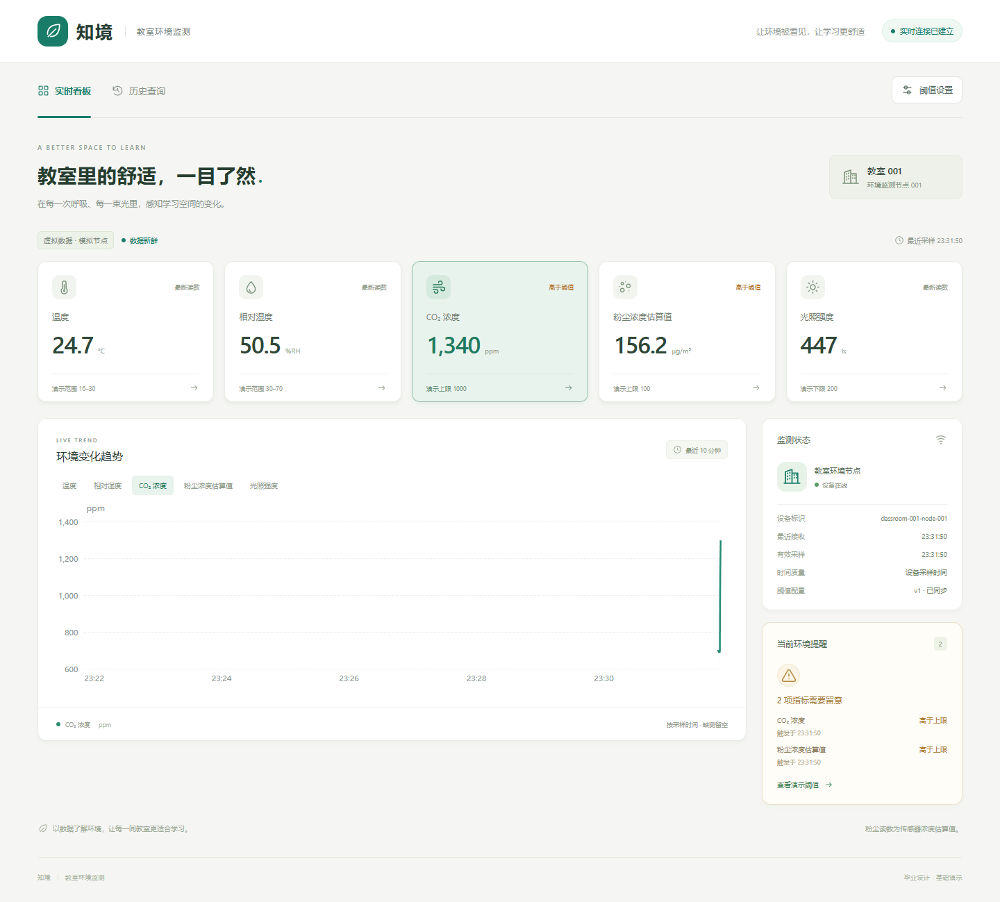
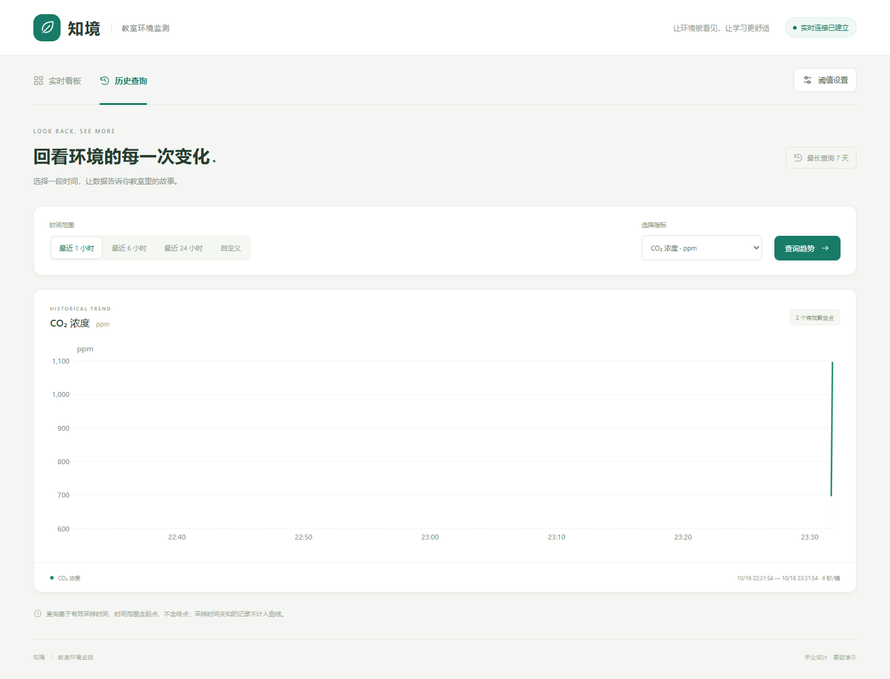
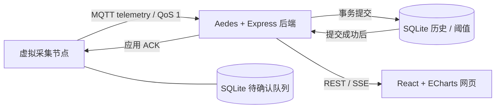

# 知境 · 教室环境质量监测

Windows 本机软件 MVP：虚拟节点每 2 秒生成五项指标，经 MQTT 上传、SQLite 持久保存，通过 REST / SSE 在 React 网页展示实时数据、历史趋势和当前报警。硬件就绪后由 STM32F103C8T6 与 ESP8266 接替虚拟节点。

**当前交付为可运行的软件验证系统，所有运行采样均来自虚拟节点。STM32 / ESP8266 固件、真实传感器采集和硬件测量尚未实现。**

第一次阅读项目，建议先看 [项目从零到完整理解](Docs/项目从零到完整理解.md)：按一条数据的完整路径讲解，随文解释术语，并用流程图说明确认、补传、报警和页面恢复。

## Android、远程查看与控制的当前状态

- 已实现手机屏幕尺寸的网页布局适配；尚无 Android 原生应用，也未完成 Android 实机接入验收。
- 网页、后端与 MQTT 默认仅监听电脑本机 `127.0.0.1`，当前没有交付局域网手机访问或外网远程查看。
- 网页支持修改服务端报警阈值；尚无向硬件下发命令、控制执行器、返回执行结果的远程控制链路。
- 硬件接线、传感器驱动、STM32 / ESP8266 固件和实测记录待器件到手后补充同步。

[开题答辩 PPT（17 页，供直接审核）](Docs/答辩材料/教室环境质量监测节点_开题答辩_审核定稿.pptx) 按开题报告的研究现状、可行性、关键问题、工作条件和进度计划组织。

[软件 MVP 成果介绍（15 页）](Docs/答辩材料/教室环境监测_软件MVP答辩.pptx) 另列软件实现、真实界面和已有验收结果。

## 已实现的功能

- 温度、湿度、CO₂、粉尘浓度估算值、光照五项指标；实时看板和按指标查询的历史趋势。
- MQTT QoS 1 上传、SQLite 持久队列、后端提交后应用 ACK、唯一键去重、断线及进程重启后的补传。
- 后端统一计算连续样本与迟滞报警；通过 SSE 推送测量、设备、报警和阈值变化。
- 明确显示虚拟数据、离线、过期、缺测与采样时间未知；旧补传不覆盖最新快照。
- Windows 一键启动、链路就绪检查、统一退出及独立测试数据的全链路验收。

## 一键启动

双击项目根目录的 **start.cmd**。也可在 PowerShell 执行：

~~~powershell
Set-Location 'D:\00_Graduation_Project'
.\start.cmd
~~~

需要 Node.js **>=24.15.0 <25**，项目基线为 Node.js 24.15.0 / npm 11.12.1。启动器检查环境和端口，缺少项目依赖时自动执行各项目的 npm ci（首次安装需要网络），每次重新构建网页，然后按顺序启动后端、网页和虚拟节点。只有后端 MQTT/SQLite 健康检查、网页 API 代理和真实应用入库 ACK 均通过，才显示“启动成功”并自动打开浏览器。

| 服务 | 默认地址 |
| --- | --- |
| 网页 | http://127.0.0.1:5173 |
| REST / SSE | http://127.0.0.1:3000/api/v1 |
| MQTT 3.1.1 | mqtt://127.0.0.1:1883 |

保留启动窗口，按 **Ctrl+C** 统一停止。节点先保存队列并发送离线状态，随后关闭网页、后端与数据库。若 Windows 询问 Terminate batch job (Y/N)?，输入 Y 结束批处理。任一服务异常退出，启动器会关闭本次启动的其他服务；端口被占用时明确报错。双击启动发生错误时窗口会暂停，方便查看原因。

日志保存在 tmp/runtime/<时间-进程号>/。历史数据与阈值持续保存到 Projects/server/data/environment.sqlite；节点待确认队列在 Projects/simulator/data/outbox.sqlite。停止和再次启动均保留数据。运行中的 SQLite 使用 WAL，备份前请正常停止系统。

启动器统一连接到 classroom-001 / classroom-001-node-001，并覆盖子项目 .env 中的连接地址、设备身份、数据库路径和上传间隔，防止三端配置不一致；其他子项目配置继续有效。启动器不改写 .env。

可选参数：

~~~powershell
# 不自动打开浏览器
.\start.cmd --no-open

# 演示正常 → CO₂/粉尘超限 → 恢复（仍每 2 秒采样）
.\start.cmd --scenario demo

# 使用另一组端口和独立演示数据库
.\start.cmd --http-port 3100 --mqtt-port 1884 --web-port 5174 --data-dir tmp/my-demo
~~~

--scenario 支持 normal（默认）、demo、co2_high、dust_high。--interval-ms 可调整采样周期，默认 2000；--data-dir 同时放置独立的 environment.sqlite 和 outbox.sqlite，相对路径以项目根目录解析。不要让两个节点同时消费同一个 outbox。

## 项目与开发

| 目录 | 职责 |
| --- | --- |
| Projects/server | Express、内嵌 Aedes MQTT、SQLite、REST、SSE、阈值与当前报警 |
| Projects/simulator | 可复现虚拟指标、持久 outbox、应用 ACK 重试与离线补传 |
| Projects/web | Vite、React、ECharts，中文实时仪表盘和历史查询 |
| scripts | 一键启动器、网页运行入口和真实全链路验收 |
| Docs/contracts | 三端及后续硬件共用 JSON Schema 和样例 |

三个项目各自维护 package.json、锁文件和 node_modules，不使用 npm workspaces。开发时在对应项目运行 npm run dev；请先停止一键启动的系统，避免端口冲突。详细说明见各项目 README。

粉尘传感器为 GP2Y1010，使用 dust_ug_m3，界面标注“粉尘浓度估算值”。本机无账号模式仅监听 127.0.0.1。报警阈值属于工程演示配置，报警状态与连续计数在后端内存中，重启后从新采样重新判断。

## 验证

~~~powershell
# 项目根目录：真实后端 + 真实虚拟节点 + Chrome，包含断线/重启和启动器检查
node scripts/verify-system.mjs
~~~

需要三个项目已经安装依赖，以及本机 Chrome（默认 C:\Program Files\Google\Chrome\Application\chrome.exe，可通过 CHROME_PATH 指定）。验收使用随机本机端口和 tmp/integration/run-* 独立数据库，不写正式数据；结束后关闭所有测试服务，保留截图、进程日志和 results.json。

各项目还可分别执行 npm test；网页另有 npm run test:browser 和构建后的 npm run test:preview。验收范围与结果见 [三端联调验收记录](Docs/三端联调验收记录.md)。

设计背景见 [软件 MVP 计划书](Docs/软件MVP计划书.md)、[技术决策记录](Docs/技术决策记录.md)、[实现共用约定](Docs/Agent提示词/MVP共用约定.md)。原始 Word 附件保持原样；接口草案和初始化阶段文档中的“尚未实现”描述是早期规划状态，以项目实现与本次验收记录为准。

## 项目边界与 AI 协作说明

本项目的软件方案、程序代码、测试与技术文档主要由 AI 编程助手在项目发起者提供的课题材料和交互要求下生成并迭代。AI 协作记录保留在 `Docs/Agent提示词/` 等设计文档中。仓库用于展示软件方案、可运行结果和验证方法，不把 AI 生成过程表述为项目发起者独立手写实现。

当前为单教室、单设备、本机无账号演示；未完成真实硬件、测量标定、设备鉴权、云部署和实体手机联调。GP2Y1010 使用“粉尘浓度估算值”，不等同于 PM2.5 参考测量。报警阈值为工程演示配置；活动报警和连续计数在后端内存中，重启后重新判断，历史与阈值仍持久保留。

GitHub Actions 配置对三个项目执行锁文件安装和各自 `npm test`，并构建网页；浏览器及真实三端联调按上文在本机运行。云端结果以仓库 Actions 首次运行结果为准。

公开仓库提交源代码、锁文件、协议、设计说明、展示截图与答辩 PPT。原始任务书、含个人信息的附件、个人求职与备答材料、运行数据库和缓存保留在本地。发布步骤、源码打包和文件范围见 [GitHub 发布说明](Docs/GitHub发布说明.md)。

